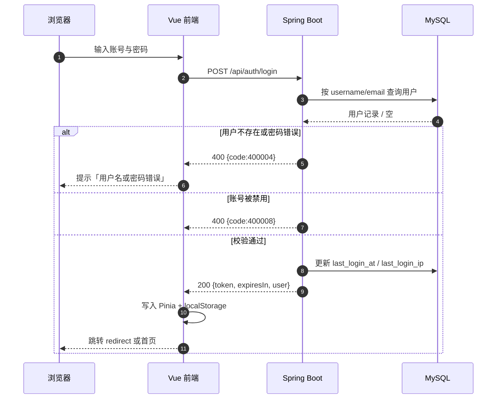
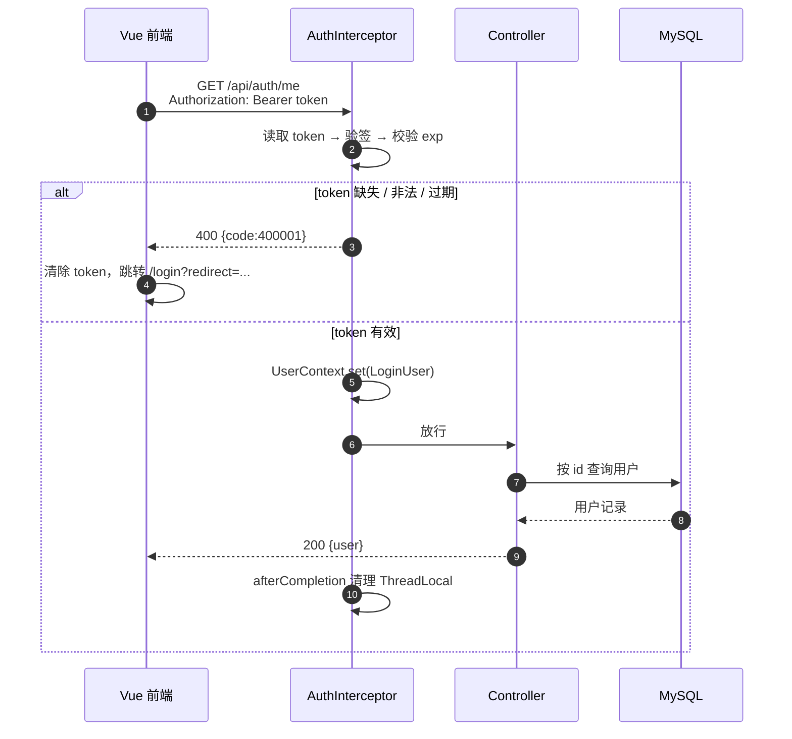

# 新功能方案：登录与鉴权

| 项 | 内容 |
|----|------|
| 所属项目 | Glean |
| 功能代号 | FEAT-AUTH |
| 版本 | v0.1 |
| 日期 | 2026-11-15 |
| 状态 | 方案已定案（待你确认后实施） |
| 确认人 | 待确认 |

> 关联文件：[建表脚本 `docs/db/schema.sql`](../../backend/src/main/resources/db/schema.sql)

---

## 1. 功能定义

| 维度 | 内容 |
|------|------|
| 产品定义 | 为 Glean 提供「账号密码注册 / 登录 + JWT 鉴权」的基础身份能力 |
| 使用者 | 未登录访客（注册、登录）、已登录用户（访问受保护接口） |
| 解决的问题 | 项目目前没有任何身份体系，后端接口无法区分请求者，前端也没有登录态 |
| 触发场景 | 未登录访问受保护页面被重定向到登录页；登录成功后携带令牌访问业务接口；刷新页面后登录态保持 |
| 输入 | 注册/登录：用户名（或邮箱）+ 密码；后续请求：`Authorization: Bearer <token>` |
| 输出 | JWT 令牌 + 脱敏用户信息；受保护接口的鉴权结果 |
| 判定标准 | ① 注册成功可直接进入已登录状态；② 密码错误返回 `400004`，不区分「账号不存在」；③ 无令牌/伪造令牌/过期令牌访问受保护接口返回 `400001`；④ 刷新浏览器登录态不丢；⑤ 改密后旧密码无法登录；⑥ 接口响应中永不出现密码字段 |
| 边界 | 本版只做：单角色普通用户、账号密码登录、JWT 单令牌、本系统自有账号体系。<br>明确不做：手机号/短信验证码、邮箱验证码、第三方 OAuth、RBAC 与权限点、管理后台、服务端令牌吊销、找回密码、多端互踢、登录限流（列为 P1/P2） |

---

## 2. 现有项目可复用部分

| 现有能力 | 位置 | 可否复用 | 说明 |
|---------|------|---------|------|
| 统一返回体 | [`Result.java`](../../backend/src/main/java/com/lilac/domain/result/Result.java) | 直接复用 | 所有接口返回 `{code,msg,data}`，鉴权失败也走它 |
| 错误码 | [`HttpsCodeEnum.java`](../../backend/src/main/java/com/lilac/enums/HttpsCodeEnum.java) | 需扩展 | 已有 `NEED_LOGIN(400001)`、`PARAMS_ERROR(400002)`、`USER_OR_PASSWORD_ERROR(400004)`、`USER_EXIST(400005)`；新增账号禁用码 |
| 业务异常 / 全局异常 | [`BusinessException.java`](../../backend/src/main/java/com/lilac/exception/BusinessException.java)、[`GlobalExceptionHandler.java`](../../backend/src/main/java/com/lilac/exception/GlobalExceptionHandler.java)、[`ThrowUtils.java`](../../backend/src/main/java/com/lilac/utils/ThrowUtils.java) | 需扩展 | 现有处理只覆盖业务异常与 404；需补参数校验异常、唯一键冲突 |
| CORS | [`CorsConfig.java`](../../backend/src/main/java/com/lilac/config/CorsConfig.java) | 直接复用 | 开发期走 Vite 代理不触发；生产需把允许源收窄 |
| Long 转字符串 | [`JacksonConfig.java`](../../backend/src/main/java/com/lilac/config/JacksonConfig.java) | 直接复用 | 所有 `Long` 序列化为字符串，前端 `id` 必须按 `string` 处理；令牌有效期字段用 `int` 规避 |
| MyBatis-Flex + Mapper 扫描 | [`pom.xml`](../../backend/pom.xml)、[`BackendApplication.java`](../../backend/src/main/java/com/lilac/BackendApplication.java) | 直接复用 | `@MapperScan("com.lilac.mapper")` 已就位，新增 Mapper 无需改启动类 |
| 数据源配置 | [`application-dev.yml`](../../backend/src/main/resources/application-dev.yml) | 需修改 | 库名仍是 `your_db` 占位，需改为实际库名并补 JDBC 参数 |
| 分页请求类 | [`PageRequest.java`](../../backend/src/main/java/com/lilac/common/PageRequest.java) | 本版不用 | 本版无列表接口 |
| AOP | `pom.xml` | 本版不用 | 鉴权改用拦截器；以后做角色/权限注解时可启用 |
| 前端 axios 实例 | [`src/api/index.ts`](../../frontend/src/api/index.ts) | 需改造 | 无拦截器、无统一错误处理，示例路径 `/user/login` 与后端不符 |
| 前端路由 / Pinia | [`src/router/index.ts`](../../frontend/src/router/index.ts)、[`src/main.ts`](../../frontend/src/main.ts) | 需扩展 | 路由为空、无 store；Pinia 已挂载 |
| API 文档工具 | [`openapi.config.js`](../../frontend/openapi.config.js)、`backend/.apifox-helper.properties` | 可选 | 后端接口可用 Apifox 导入后生成前端类型，本方案不依赖 |

**现有技术栈**：Java 17 / Spring Boot 3.5.13 / MyBatis-Flex 1.11.1 / MySQL 8 / Hutool 5.8.44 / H2（仅测试）；前端 Vue 3.5 + TypeScript + Vite 8 + Pinia 4 + vue-router 5 + axios。后端端口 9090，`context-path=/api`。

---

## 3. 技术难点拆解

| # | 环节 | 难度 | 是否接触过 | 成熟方案 |
|---|------|------|-----------|---------|
| ① | 密码安全存储与校验 | 低 | 大概率接触过 | 现成（BCrypt，Hutool 内置） |
| ② | 令牌签发、验签、过期判断 | 低 | 可能接触过 | 现成（Hutool JWT） |
| ③ | 每个请求识别用户并拦截未登录 | 中 | 否 | 自研拦截器 + ThreadLocal，约 100 行 |
| ④ | 注册的并发唯一性 | 低 | 否 | 现成（唯一索引 + 异常转换） |
| ⑤ | 前端登录态保持与路由守卫 | 低 | 可能接触过 | 现成（Pinia + vue-router 守卫） |
| ⑥ | 前后端联调（context-path 与代理前缀） | 低 | 否 | 配置修正，无代码量 |

---

## 4. 方案对比与选择

### 4.1 密码存储

| 路径 | 类型 | 方案 | 优点 | 缺点 | 学习成本 |
|------|------|------|------|------|---------|
| A | 现成 | Hutool `cn.hutool.crypto.digest.BCrypt`（cost=10） | 已在依赖内、自动加盐、可调 cost | 输入上限 72 字节 | 低 |
| B | 现成 | Argon2id（spring-security-crypto / BouncyCastle） | 抗 GPU 更强 | 需新增依赖、参数需调优 | 中 |
| C | 自研 | SHA-256 + 随机盐 + 迭代 | 无依赖 | 易写错，抗暴力弱，不建议 | 中 |

**推荐：A**。项目已引入 Hutool，BCrypt 是密码哈希的成熟默认选择，无需新增依赖。
**最终选定：A（BCrypt，cost=10）**。约束：密码限定 8-32 位可见 ASCII 字符并同时包含字母与数字，避开 BCrypt 72 字节截断问题。

### 4.2 令牌方案

| 路径 | 类型 | 方案 | 优点 | 缺点 | 学习成本 |
|------|------|------|------|------|---------|
| A | 现成 | JWT 单令牌（HS256，2 小时） | 无状态、零新增依赖、前端实现简单 | 服务端无法主动吊销，禁用/改密后旧令牌最长 2 小时内仍有效 | 低 |
| B | 半现成 | JWT + Refresh Token | 可续期、可撤销 | 多一张令牌表、多一套刷新与轮换逻辑 | 中 |
| C | 现成 | Sa-Token | 踢人下线、自动续签开箱即用 | 新增依赖；多实例需 Redis | 中 |
| D | 自研 | Session + Cookie | 服务端可控 | 跨域/移动端麻烦，与当前 SPA + 代理结构不契合 | 中 |

**推荐：A**，与你已选的方案一致。理由：当前是单机、单角色、无管理后台的内部项目，2 小时 TTL 把「无法吊销」的窗口限制在可接受范围，后续要升级 B 只需加一张表和 `/refresh` 接口，不影响现有接口契约。
**最终选定：A（JWT 单令牌，HS256，TTL 7200 秒）**。

### 4.3 鉴权落地方式

| 路径 | 类型 | 方案 | 优点 | 缺点 | 学习成本 |
|------|------|------|------|------|---------|
| A | 自研 | `HandlerInterceptor` 统一解析 + `ThreadLocal` 用户上下文 | 一次解析全站生效，白名单集中配置，约百行 | 需自己处理线程清理、OPTIONS、异常路径 | 低 |
| B | 现成 | Spring Security 过滤器链 | 标准化，生态完整 | 配置与异常响应改造成本高，对当前需求过重 | 高 |
| C | 自研 | 每个接口手动解析 | 直观 | 重复代码多、容易漏 | 低 |

**推荐：A**。这与项目现有「轻量、手写、约定优先」的风格一致；AOP 注解留到以后做角色校验时再加。
**最终选定：A（拦截器 + ThreadLocal，`@AuthCheck` 注释留作扩展）**。

### 4.4 前端令牌存放

| 路径 | 类型 | 方案 | 优点 | 缺点 | 学习成本 |
|------|------|------|------|------|---------|
| A | 现成 | `localStorage` 存 token | 刷新不丢、实现最简单 | XSS 可读取 | 低 |
| B | 现成 | `HttpOnly` Cookie | 脚本读不到，XSS 风险低 | 需 CSRF 防护、跨域配置、后端下发 Cookie | 中 |
| C | 自研 | 仅内存 | XSS 影响最小 | 刷新即掉登录 | 低 |

**推荐：A**。首版以跑通闭环为先，配合「禁用 `v-html`、依赖审计、后续加 CSP」缓解 XSS；若项目面向公网高敏数据，升级 B。
**最终选定：A（localStorage，key 为 `glean_token`）**。

### 4.5 登录防护

| 路径 | 类型 | 方案 | 优点 | 缺点 |
|------|------|------|------|------|
| A | 自研 | 登录失败统一返回 `400004`，不区分账号不存在/密码错误 | 防账号枚举，零成本 | 无法阻止暴力破解 |
| B | 自研 | 内存滑动窗口限流（单机） | 零依赖，能挡脚本 | 多实例失效、重启清零 |
| C | 现成 | Redis / 网关限流 | 多实例有效 | 需新增基础设施 |

**最终选定：A（本版）+ B（P1 可选）**；C 留到部署多实例时再做。

---

## 5. 选定技术组合

| 环节 | 选定方案 | 类型 | 来源 / 链接 | 维护状态 |
|------|---------|------|------------|---------|
| 密码哈希 | BCrypt（cost=10） | 现成 | Hutool 5.8.44 内置 `cn.hutool.crypto.digest.BCrypt` | 项目现有依赖，无新增风险 |
| 令牌 | JWT HS256 | 现成 | Hutool 5.8.44 内置 `cn.hutool.jwt`（5.7.0 起提供） | 项目现有依赖，无新增风险 |
| 请求鉴权 | 拦截器 + ThreadLocal | 自研 | — | 约 100 行，逻辑简单 |
| 参数校验 | `spring-boot-starter-validation` | 现成 | Spring Boot 官方 starter，版本由 parent 3.5.13 管理 | 官方维护 |
| 数据库 | MySQL 8 + MyBatis-Flex | 现成 | 项目已有 | 现有依赖 |
| 前端状态 | Pinia + localStorage | 现成 | 项目已有 | 现有依赖 |

**整个方案只新增一个官方 starter（validation）**，其余全部复用现有依赖。
调研依据：库的字段命名规则与 JWT 用法核查于 2026-11-15；MyBatis-Flex `@Table.camelToUnderline` 默认 `true`（[官方文档](https://mybatis-flex.com/zh/core/table.html)）。

---

## 6. 需求拆分

> 估时口径：1 天 = 4 小时有效工时，粒度 2-8 小时。

### 需求 1：建库建表与数据源

- 做什么：执行 [`schema.sql`](../../backend/src/main/resources/db/schema.sql) 创建 `glean` 库与 `sys_user` 表；把 `application-dev.yml` 的库名从 `your_db` 改为实际库名并补 JDBC 参数。
- 怎么做：现成工具 — MySQL DDL；复用现有 Hikari 数据源配置。
- 验收：`SHOW TABLES` 能看到 `sys_user`；后端能正常启动且不报数据源错误；`DESC sys_user` 字段与本文档一致。
- 估时：2 小时
- 风险：本机 MySQL 版本低于 8.0 时 `utf8mb4_0900_ai_ci` 不可用，需改 `utf8mb4_unicode_ci`。

### 需求 2：用户实体、Mapper 与注册/登录服务

- 做什么：`User` 实体、`UserMapper`、`AuthService` 的注册与登录逻辑：账号规范化、唯一性校验、BCrypt 哈希、状态校验、更新最近登录时间/IP。
- 怎么做：现成（MyBatis-Flex + Hutool BCrypt）。
- 验收：注册成功返回 200 且 `data.token` 非空；重复用户名/邮箱返回 `400005`；密码错误与账号不存在都返回 `400004`；数据库密码字段以 `$2a$` 开头且长度 60。
- 估时：4 小时
- 风险：并发注册时先查后插存在竞态，必须依赖唯一索引并捕获 `DuplicateKeyException` 兜底。

### 需求 3：JWT 工具与登录拦截器

- 做什么：`JwtUtils`（签发/解析/校验）、`LoginUser`、`UserContext`、`AuthInterceptor`、`WebMvcConfig` 注册拦截器与白名单。
- 怎么做：自研 — 现有项目无鉴权能力，约 100 行；JWT 编解码复用 Hutool。
- 验收：带合法 token 访问 `GET /api/auth/me` 返回 200；无 token、签名被改、已过期均返回 `400001`；`OPTIONS` 预检放行；`/error` 不被拦截；并发请求之间用户信息不串。
- 估时：3 小时
- 风险：`ThreadLocal` 未在 `afterCompletion` 清理会串号；密钥硬编码会泄密。

### 需求 4：`/me`、改密、登出接口

- 做什么：当前用户信息、修改密码、登出三个接口；VO 脱敏。
- 怎么做：复用现有 `Result`；改密复用 BCrypt。
- 验收：`/me` 响应不含 `password`；旧密码错误返回 `400004`；改密成功后旧密码登录失败、新密码成功；登出接口返回 200（无状态，服务端无需处理）。
- 估时：2 小时
- 风险：改密后旧 token 仍有效（见第 7 节），需在前端提示并清理本地登录态。

### 需求 5：参数校验与异常处理补齐

- 做什么：新增 validation 依赖；DTO 加校验注解；`GlobalExceptionHandler` 增加参数校验异常与唯一键冲突处理；`HttpsCodeEnum` 增加 `ACCOUNT_DISABLED(400008)`。
- 怎么做：现成（Spring Validation）。
- 验收：空密码、短密码、非法用户名返回 `400002` 且 `msg` 可读；重复提交触发唯一键冲突时不返回 500。
- 估时：1.5 小时
- 风险：新增依赖需同步 CI（影响极小）。

### 需求 6：前端请求层、用户 store 与路由守卫

- 做什么：`request.ts`（携带 Bearer、解包 Result、`400001` 统一跳登录）、`api/auth.ts`、`stores/user.ts`、路由表与全局守卫、`App.vue`。
- 怎么做：现成（axios + Pinia + vue-router）。
- 验收：登录后刷新页面仍保持；令牌失效时访问受保护页自动跳登录并带 `redirect`；退出后回到登录页；登录后访问 `/login` 自动回首页。
- 估时：4 小时
- 风险：请求层与路由/store 循环依赖，`400001` 处理需避免重复跳转。

### 需求 7：登录/注册页与联调修正

- 做什么：登录页、注册页（含前端校验与错误提示）、首页占位（显示昵称 + 退出）；修正 Vite 代理把 `/api` 重写掉的问题。
- 怎么做：现成（Vue 3 单文件组件）+ 自研页面。
- 验收：浏览器完整走通「注册 → 自动登录 → 刷新 → 退出 → 登录」；Network 中请求均为 `/api/auth/*`；错误提示与后端 `msg` 一致。
- 估时：4 小时
- 风险：代理配置改错导致 404/跨域；表单校验与后端规则不一致。

**汇总**

| 需求 | 类型 | 估时 |
|------|------|------|
| 1 建库建表与数据源 | 现成 | 2h |
| 2 实体/Mapper/注册登录 | 现成 | 4h |
| 3 JWT 与拦截器 | 自研 | 3h |
| 4 me/改密/登出 | 现成 | 2h |
| 5 校验与异常补齐 | 现成 | 1.5h |
| 6 前端请求层/store/守卫 | 现成 | 4h |
| 7 页面与联调 | 自研 | 4h |
| **合计** | — | **约 20.5 小时，5 天** |

---

## 7. 风险与注意事项

| 风险 | 影响 | 应对方案 |
|------|------|---------|
| 单令牌无法服务端吊销 | 禁用账号或改密后，旧 token 最长 2 小时内仍可访问 | TTL 设 2 小时；改密后前端强制重新登录；升级路径：用户表加 `token_version`，JWT 带 `ver` 并在拦截器查缓存/库 |
| token 存 localStorage | XSS 可窃取 | 禁用 `v-html`、审计第三方依赖、后续加 CSP；高安全场景改 HttpOnly Cookie + CSRF |
| 无 Redis 限流 | 内存限流只对单机有效 | 本版只做统一错误信息；P1 加内存限流；多实例时用 Redis/网关 |
| 鉴权失败返回 HTTP 400 | 与 REST 的 401 习惯不同，第三方联调可能困惑 | 沿用项目现有「HTTP 400 + 业务码」约定；前端按 `code` 判断；若需标准 401，可给 `NEED_LOGIN` 单独加异常处理器 |
| `map-underscore-to-camel-case: false` | 手写 XML 时列名可能不匹配 | 实体列名由 `@Table.camelToUnderline` 控制（默认 true），本方案不写 XML；如后续加 XML，显式写 snake_case 列名 |
| MyBatis-Flex 插入 null 字段 | NOT NULL 列报错 | 使用 `insertSelective` 或在服务层显式设置时间字段；DDL 已给默认值 |
| H2 与 MySQL 的 DDL 差异 | 后续集成测试建表失败 | 本版 CI 只加载上下文；加集成测试时使用 H2 简化 DDL 或 Testcontainers（P2） |
| 注册接口可枚举用户名 | 可探测某账号是否存在 | 当前可接受；P2 改用邀请码/验证码注册 |
| 密码多字节字符超 72 字节 | BCrypt 静默截断 | 限定可见 ASCII 8-32 位，校验规则前后端一致 |
| 生产 CORS 过宽 | 任意源可发起带凭据请求 | 生产环境把 `allowedOriginPatterns` 收窄为前端域名；Bearer 方案本身不依赖 Cookie |
| fastjson 1.2.83 版本较旧 | 历史反序列化漏洞 | 本方案不新增使用；HTTP 序列化走 Jackson；建议后续移除该注解依赖 |

---

## 8. 方案变更记录

| 日期 | 变更内容 | 原因 | 确认人 |
|------|---------|------|--------|
| 2026-11-15 | 初版定案 | — | 待确认 |

---

## 9. 数据库设计

### 9.1 表清单

| 表 | 是否必建 | 用途 |
|----|---------|------|
| `sys_user` | 必建 | 账号、密码哈希、昵称、状态、最近登录信息 |
| `sys_login_log` | P1 可选 | 登录审计；不做审计可整段删除 |

当前**不建** `role` / `permission` / `user_token` 表：单角色普通用户 + 无状态 JWT 用不到；需要时的升级路径见 9.5。

### 9.2 `sys_user` 字段

| 字段 | 类型 | 允许空 | 默认值 | 说明 |
|------|------|-------|--------|------|
| `id` | `BIGINT` | 否 | 自增 | 主键；接口序列化为字符串 |
| `username` | `VARCHAR(32)` | 否 | — | 登录账号，4-20 位字母/数字/下划线，服务端统一转小写 |
| `password` | `VARCHAR(100)` | 否 | — | BCrypt 哈希（60 字符），预留算法升级长度 |
| `nickname` | `VARCHAR(32)` | 否 | `''` | 昵称，注册时默认等于 username |
| `email` | `VARCHAR(128)` | 是 | `NULL` | 可选，可用于登录；统一小写 |
| `avatar` | `VARCHAR(512)` | 是 | `NULL` | 头像 URL |
| `status` | `TINYINT` | 否 | `0` | `0` 正常，`1` 禁用 |
| `last_login_at` | `DATETIME` | 是 | `NULL` | 最近登录时间 |
| `last_login_ip` | `VARCHAR(45)` | 是 | `NULL` | 最近登录 IP，兼容 IPv6 |
| `created_at` | `DATETIME` | 否 | `CURRENT_TIMESTAMP` | 创建时间 |
| `updated_at` | `DATETIME` | 否 | 自动更新 | 更新时间 |

### 9.3 索引与约束

| 名称 | 类型 | 字段 | 作用 |
|------|------|------|------|
| `PRIMARY` | 主键 | `id` | — |
| `uk_username` | 唯一 | `username` | 账号唯一，兼作登录查询索引 |
| `uk_email` | 唯一 | `email` | 邮箱唯一；MySQL 允许出现多个 `NULL`，未填邮箱不冲突 |
| `idx_status` | 普通 | `status` | 按状态筛选（禁用/正常） |

字符集 `utf8mb4`、排序规则 `utf8mb4_0900_ai_ci`（大小写不敏感），需 MySQL 8.0+。

### 9.4 设计取舍

- **为什么只有一张表**：单角色 + 无状态令牌，角色、令牌都不需要落库；多建表只会增加空转成本。
- **为什么不加 `role` 字段**：你明确本版只有普通用户。以后要加管理端时，加 `role VARCHAR(16)` 或拆 RBAC 表都不影响现有数据；提前加一个永远取 `user` 的字段没有意义。
- **为什么 `email` 可空且唯一**：注册只强制用户名 + 密码；邮箱是可选登录方式。唯一索引保证「一个邮箱只能绑一个账号」。
- **为什么没有 `deleted`**：逻辑删除与唯一索引冲突（注销后同名账号无法重新注册，除非引入改名或 `(username, deleted)` 组合索引，而组合索引在多次删除后仍会冲突）。本版用 `status` 禁用代替；确需注销时物理删除或把 `username` 改写为 `deleted_{id}_{原名}`。
- **为什么密码列给到 100**：BCrypt 固定 60 字符，留出未来切 Argon2id 或加前缀的空间。
- **为什么 `id` 用 `BIGINT` 自增**：与 MyBatis-Flex `KeyType.Auto` 配合最顺；Jackson 已把 Long 转字符串，前端不会丢精度。
- **时间字段由谁维护**：DDL 给了数据库默认值与自动更新；若 MyBatis-Flex 插入时带 null，使用 `insertSelective` 或服务层显式赋值，避免 NOT NULL 报错。

### 9.5 升级预留

| 后续需求 | 改动 |
|---------|------|
| 服务端吊销 / 改密立即失效 | `sys_user` 加 `token_version INT`，JWT 带 `ver`，拦截器比对（查库或 Redis） |
| 多端登录、刷新令牌 | 新增 `sys_user_token`（`user_id`、`refresh_token_hash`、`expires_at`、`revoked`、`user_agent`、`ip`） |
| 管理后台 / 权限点 | `sys_user` 加 `role`，或新增 `sys_role`、`sys_user_role`、`sys_permission` |
| 登录审计 | 启用 `sys_login_log` |
| 手机号登录 | `sys_user` 加 `phone VARCHAR(20)` 与唯一索引；新增短信验证码表/缓存 |

### 9.6 建表脚本

见 [`docs/db/schema.sql`](../../backend/src/main/resources/db/schema.sql)，包含 `CREATE DATABASE`、`sys_user` 与可选的 `sys_login_log`。

---

## 10. 接口契约

### 10.1 通用约定

- 基础路径：`/api`（`server.servlet.context-path`），控制器内路径不带 `/api`。
- 请求/响应均为 `application/json;charset=UTF-8`。
- 响应统一为 `{ "code": number, "msg": string, "data": any }`；`code=200` 表示成功。
- 鉴权失败：HTTP 400，`code=400001`（沿用现有全局异常约定，前端按 `code` 判断）。
- 认证头：`Authorization: Bearer <token>`；令牌缺失、格式错误、签名错误、过期统一返回 `400001`。
- 所有 `Long` 字段序列化为字符串，前端 `id` 用 `string`；`expiresIn` 用 `int`，保持数字。
- 时间字段为 ISO-8601 本地时间，如 `2026-11-15T16:00:00`。

### 10.2 错误码

| code | 含义 | 触发场景 |
|------|------|---------|
| `200` | 成功 | — |
| `400001` | 需要登录 | 无 token / 格式错误 / 验签失败 / 已过期 |
| `400002` | 参数错误 | 参数校验失败 |
| `400004` | 用户名或密码错误 | 账号不存在或密码错误（统一提示） |
| `400005` | 用户已存在 | 注册时用户名或邮箱重复 |
| `400008` | 账号已被禁用 | `status=1` 的用户登录 |
| `500` | 系统内部错误 | 未捕获异常 |

### 10.3 接口列表

| 方法 | 路径 | 鉴权 | 说明 |
|------|------|------|------|
| POST | `/api/auth/register` | 否 | 注册并自动登录 |
| POST | `/api/auth/login` | 否 | 登录 |
| GET | `/api/auth/me` | 是 | 当前用户信息 |
| PUT | `/api/auth/password` | 是 | 修改密码 |
| POST | `/api/auth/logout` | 是 | 登出（无状态，返回成功即可） |

### 10.4 注册

`POST /api/auth/register`

```json
{
  "username": "alice",
  "password": "Passw0rd",
  "email": "alice@example.com",
  "nickname": "Alice"
}
```

- `username`：必填，4-20 位字母/数字/下划线，服务端转小写。
- `password`：必填，8-32 位可见 ASCII，至少含字母与数字。
- `email`：可选，格式校验，服务端转小写。
- `nickname`：可选，缺省取 `username`。

成功（`data` 与登录相同，注册即登录）：

```json
{
  "code": 200,
  "msg": "操作成功",
  "data": {
    "token": "eyJ0eXAiOiJKV1Qi...",
    "tokenType": "Bearer",
    "expiresIn": 7200,
    "user": {
      "id": "1",
      "username": "alice",
      "nickname": "Alice",
      "email": "alice@example.com",
      "avatar": null
    }
  }
}
```

失败：`400002`（参数不合法）、`400005`（用户名或邮箱已存在）。

### 10.5 登录

`POST /api/auth/login`

```json
{ "account": "alice", "password": "Passw0rd" }
```

- `account`：用户名或邮箱，服务端 trim + 转小写后匹配。
- 成功响应同 10.4。
- 失败：`400002`、`400004`（账号不存在或密码错误）、`400008`（账号被禁用）。

### 10.6 当前用户

`GET /api/auth/me`

```json
{
  "code": 200,
  "msg": "操作成功",
  "data": {
    "id": "1",
    "username": "alice",
    "nickname": "Alice",
    "email": "alice@example.com",
    "avatar": null,
    "status": 0,
    "lastLoginAt": "2026-11-15T16:00:00"
  }
}
```

失败：`400001`。

### 10.7 修改密码

`PUT /api/auth/password`

```json
{ "oldPassword": "Passw0rd", "newPassword": "NewPassw0rd" }
```

- 成功后前端应清除本地 token 并跳转登录页（服务端不维护令牌状态）。
- 失败：`400001`、`400002`、`400004`（旧密码错误）。

### 10.8 登出

`POST /api/auth/logout`

- 无请求体；返回 `{ "code": 200, "msg": "操作成功", "data": null }`。
- 无状态令牌无法真正吊销，前端必须清除本地 token；该接口保留是为了将来接入黑名单时前端无需改动。

### 10.9 登录时序



### 10.10 请求鉴权时序



---

## 11. 后端实现清单

### 11.1 目录结构（新增）

```
backend/src/main/java/com/lilac/
├── auth/
│   ├── JwtUtils.java            # 签发、解析、校验
│   ├── AuthInterceptor.java     # 拦截器：取 token → 校验 → 写入上下文
│   ├── LoginUser.java           # 当前登录用户（id、username）
│   └── UserContext.java         # ThreadLocal 持有 LoginUser
├── config/
│   ├── AuthProperties.java      # glean.auth.* 配置绑定 + 启动校验
│   └── WebMvcConfig.java        # 注册拦截器、白名单
├── controller/
│   └── AuthController.java      # 5 个接口
├── service/
│   ├── AuthService.java
│   └── impl/AuthServiceImpl.java
├── mapper/
│   └── UserMapper.java          # extends BaseMapper<User>
├── domain/
│   ├── entity/User.java
│   ├── dto/auth/RegisterRequest.java
│   ├── dto/auth/LoginRequest.java
│   ├── dto/auth/ChangePasswordRequest.java
│   ├── vo/LoginVO.java
│   └── vo/UserVO.java
└── enums/
    └── UserStatusEnum.java
```

### 11.2 类职责

| 类 | 职责 |
|----|------|
| `JwtUtils` | 用 HS256 签发 `sub/username/iat/exp/iss`；解析并返回 `LoginUser`；任何异常转 `BusinessException(NEED_LOGIN)` |
| `AuthInterceptor` | `preHandle`：放行 `OPTIONS`；取 `Authorization`，校验后 `UserContext.set`；失败抛 `NEED_LOGIN`。`afterCompletion`：`UserContext.clear()` |
| `UserContext` | `ThreadLocal<LoginUser>`，提供 `set/get/clear/getRequired` |
| `AuthProperties` | 绑定 `glean.auth.jwt-secret`、`glean.auth.token-expire-seconds`、`glean.auth.issuer`；启动时校验密钥长度 ≥ 32 字节 |
| `WebMvcConfig` | `addInterceptors`：`/**` 拦截，排除 `/auth/login`、`/auth/register`、`/error` |
| `AuthController` | 参数绑定与校验，调用 `AuthService`，包装 `Result` |
| `AuthServiceImpl` | 注册（查重、BCrypt、插入、签发）、登录（查用户、校验密码/状态、更新登录信息）、改密、查询当前用户 |
| `UserMapper` | MyBatis-Flex `BaseMapper<User>`，无需 XML |
| `User` | `@Table("sys_user")`、`@Id(keyType = KeyType.Auto)`；字段与表一一对应 |
| `UserStatusEnum` | `NORMAL(0)`、`DISABLED(1)` |

### 11.3 需要改动的现有文件

| 文件 | 改动 |
|------|------|
| [`pom.xml`](../../backend/pom.xml) | 增加 `spring-boot-starter-validation`（唯一新增依赖） |
| [`HttpsCodeEnum.java`](../../backend/src/main/java/com/lilac/enums/HttpsCodeEnum.java) | 增加 `ACCOUNT_DISABLED(400008, "账号已被禁用")` |
| [`GlobalExceptionHandler.java`](../../backend/src/main/java/com/lilac/exception/GlobalExceptionHandler.java) | 增加 `MethodArgumentNotValidException`（→ `400002`，取首条字段错误）、`DuplicateKeyException`（→ `400005` 或统一操作失败）、`HttpMessageNotReadableException`（→ `400002`） |
| [`application.yml`](../../backend/src/main/resources/application.yml) | 增加 `glean.auth.jwt-secret`、`token-expire-seconds`、`issuer` |
| [`application-dev.yml`](../../backend/src/main/resources/application-dev.yml) | 库名改为 `glean`，补 `serverTimezone`、`characterEncoding`、`useSSL=false` 等参数 |
| [`CorsConfig.java`](../../backend/src/main/java/com/lilac/config/CorsConfig.java) | 本版不动；上线前把允许源收窄（可改为读取配置项） |

### 11.4 实现要点

1. **密钥管理**：`glean.auth.jwt-secret: ${AUTH_JWT_SECRET:}`，开发值放 `application-dev.yml`（已被 git 忽略），生产由环境变量注入；启动时长度不足直接失败，禁止使用默认弱密钥。
2. **令牌载荷**：`sub` 为 userId（字符串）、`username`、`iss=glean`、`iat`、`exp`；不放入邮箱、昵称等 PII，不放角色（本版无角色）。
3. **校验顺序与算法**：固定算法为 HS256（用 `JWTValidator.validateAlgorithm(JWTSignerUtil.hs256(secret))` 同时校验算法与签名），再校验 `exp`；拒绝 header 中其他 `alg`，防止算法混淆攻击；所有失败统一 `400001`，日志区分原因便于排查。
4. **登录失败统一提示**：账号不存在时也返回 `400004`；可选地执行一次假 BCrypt 校验以削弱时间差（P2）。
5. **状态检查**：`status=1` 在密码校验通过后返回 `400008`，避免把「账号存在但禁用」暴露给错误密码的请求。
6. **注册竞态**：先查重给出友好提示，插入时捕获 `DuplicateKeyException` 兜底转 `400005`。
7. **登录信息更新**：只更新 `last_login_at`、`last_login_ip` 两列，不要整行覆盖，避免覆盖并发修改。
8. **密码字段**：DTO 入参、VO 出参都不含 `password`；日志打印请求体时要脱敏（登录接口）。
9. **`expiresIn` 用 `int`**：Jackson 已把 `Long`/`long` 序列化为字符串，用 `int` 才能保持数字。
10. **拦截器细节**：`OPTIONS` 直接放行；`/error` 排除；`afterCompletion` 必须 `finally` 清理；静态资源不存在也不受影响。
11. **MyBatis-Flex 命名**：`@Table("sys_user")` 默认 `camelToUnderline=true`，`createdAt` 自动映射 `created_at`；`map-underscore-to-camel-case: false` 不影响实体映射（MyBatis-Flex 自建映射），但以后手写 XML 要写 snake_case 列名。
12. **时间字段**：优先用 `@Column(onInsertValue = "now()")` / `onUpdateValue = "now()"`，或服务层显式赋值；插入用 `insertSelective`，避免 null 覆盖默认值。

---

## 12. 前端改造清单

### 12.1 文件与动作

| 文件 | 动作 | 说明 |
|------|------|------|
| [`vite.config.ts`](../../frontend/vite.config.ts) | 修改 | 删除 `rewrite: (path) => path.replace(/^\/api/, '')`；后端 context-path 已是 `/api`，重写会 404 |
| `src/utils/request.ts` | 新建 | axios 实例：baseURL 取 `VITE_API_BASE_URL`；请求头加 `Bearer`；响应解包 `Result`；`400001` 统一处理 |
| `src/api/auth.ts` | 新建 | `register`、`login`、`getMe`、`changePassword`、`logout` |
| [`src/api/index.ts`](../../frontend/src/api/index.ts) | 修改 | 删除错误的示例 `login`，或改为统一导出 `request` |
| `src/stores/user.ts` | 新建 | state：`token`、`user`；actions：`login`、`register`、`fetchMe`、`logout`；token 持久化到 `localStorage['glean_token']` |
| [`src/router/index.ts`](../../frontend/src/router/index.ts) | 修改 | 增加 `/login`、`/register`、`/` 三条路由与全局守卫 |
| `src/views/LoginView.vue` | 新建 | 账号 + 密码表单、错误提示、提交 loading |
| `src/views/RegisterView.vue` | 新建 | 用户名/密码/确认密码/邮箱（可选）、前端校验 |
| `src/views/HomeView.vue` | 新建 | 显示昵称 + 退出按钮（业务首页占位） |
| [`src/App.vue`](../../frontend/src/App.vue) | 修改 | 加入 `<RouterView />` 与基础样式 |
| `src/types/auth.ts` | 可选新建 | `LoginResult`、`UserInfo` 等类型；`id` 用 `string` |

### 12.2 关键逻辑

- **请求拦截**：从 localStorage 读 token，存在则加 `Authorization: Bearer <token>`。
- **响应拦截**：`code === 200` 时返回 `data`；`400001` 时清 token、跳 `/login?redirect=<当前路径>`；其余弹错误提示（登录/注册页用内联提示）。
- **避免循环依赖**：`request.ts` 不要直接 import store（store 依赖 request）。可在拦截器中 `import('@/router')` 动态引入，或用 `window.location` 兜底；跳转需加「正在跳转」标记，防止并发 401 反复跳。
- **路由守卫**：
  - 公开页（`/login`、`/register`）：已登录则跳 `redirect` 或 `/`。
  - 受保护页：无 token → `/login?redirect=to.fullPath`；有 token 但无 `user` → `fetchMe()`，失败则清登录态并跳登录。
- **登录成功**：`redirect` 参数只接受站内路径（以 `/` 开头且不以 `//` 开头），避免开放重定向。
- **表单规则与后端一致**：用户名 4-20 位字母/数字/下划线；密码 8-32 位且含字母和数字；确认密码一致；邮箱格式。
- **退出**：调用 `/auth/logout`（失败也继续）→ 清 store 与 localStorage → 跳 `/login`。
- **UI**：本版不引入组件库，原生表单 + 少量 CSS；如果后续加 Element Plus，只替换视图层，不影响请求层与 store。

### 12.3 Vite 代理修正

现状：浏览器请求 `/api/auth/login` → Vite 把 `/api` 重写掉 → 后端收到 `/auth/login` → 但后端 context-path 是 `/api`，实际只认 `/api/auth/login`，结果 404。

修正：保留代理，删除 `rewrite`，让 `/api` 原样转发：

```ts
server: {
  proxy: {
    '/api': {
      target: 'http://localhost:9090',
      changeOrigin: true,
    },
  },
},
```

---

## 13. 测试与验收

### 13.1 后端用例

| # | 场景 | 预期 |
|---|------|------|
| 1 | 合法注册 | 200，`data.token` 非空，`data.user.id` 为字符串 |
| 2 | 重复用户名注册 | 400，`code=400005` |
| 3 | 重复邮箱注册 | 400，`code=400005` |
| 4 | 密码过短 / 无数字 | 400，`code=400002` |
| 5 | 正确账号密码登录 | 200，返回 token |
| 6 | 错误密码登录 | 400，`code=400004` |
| 7 | 不存在的账号登录 | 400，`code=400004`（与 6 提示一致） |
| 8 | 禁用账号登录 | 400，`code=400008` |
| 9 | 无 token 访问 `/api/auth/me` | 400，`code=400001` |
| 10 | 篡改 token 访问 `/api/auth/me` | 400，`code=400001` |
| 11 | 过期 token 访问（临时把 TTL 改为 5 秒验证） | 400，`code=400001` |
| 12 | 合法 token 访问 `/api/auth/me` | 200，不含 `password` |
| 13 | 旧密码错误时改密 | 400，`code=400004` |
| 14 | 改密成功 | 200；旧密码登录失败、新密码成功 |
| 15 | `OPTIONS /api/auth/login` 预检 | 不被拦截器拦截 |
| 16 | 不存在的路径 `/api/nope` | 404，不应变成 `400001` |
| 17 | 篡改 header 的 `alg`（改成 `none` 或换成其他算法） | 400，`code=400001` |

### 13.2 前端手工验收

1. 未登录访问 `/` → 跳 `/login`，登录后回到 `/`。
2. 登录后刷新页面 → 仍为登录态，不闪回登录页。
3. 手动删除 localStorage 中 token 后访问 `/` → 跳登录。
4. token 过期后任意请求 → 自动清登录态并跳登录，只跳一次。
5. 注册 → 自动登录 → 首页显示昵称。
6. 退出 → 回登录页，回退浏览器不恢复登录态（可再加 `history.replaceState` 处理）。
7. 登录页输入错误密码 → 显示后端 `msg`，不出现 `undefined`。

### 13.3 自动化建议（P2）

- `JwtUtils` 单测：正常签发/解析、过期、篡改、错误密钥。
- `AuthService` 单测：注册重复、密码校验、禁用账号。
- MockMvc 集成测试：注册→登录→me→改密全链路；测试库用 H2 简化版建表脚本（去掉 `ON UPDATE` 等 MySQL 专有语法）。
- CI 已配置（`.github/workflows/backend-ci.yml`、`frontend-ci.yml`），新增代码需通过 `mvn verify` 与 `npm run build`。

---

## 14. 实施顺序

1. 需求 1：建库建表 + 数据源（先让后端能连上库）。
2. 需求 2：实体/Mapper/注册登录（用 curl 能拿到 token）。
3. 需求 3：JWT + 拦截器（用 curl 验证 401 分支）。
4. 需求 4 + 5：其余接口 + 校验/异常（补齐契约）。
5. 需求 6：前端请求层、store、路由守卫（先能登录、能保持）。
6. 需求 7：页面与联调（完整走通）。

后端可先用 curl 自测，再动前端；前端联调时优先修代理，否则会误判为 CORS 问题。

---

## 15. 本方案采用的默认假设

| 项 | 假设 | 如需调整 |
|----|------|---------|
| 数据库名 | `glean` | 改 `schema.sql` 与 `application-dev.yml` |
| MySQL 版本 | 8.0+，`utf8mb4_0900_ai_ci` | 5.7 改用 `utf8mb4_unicode_ci` |
| 注册行为 | 注册成功即自动登录 | 改为只返回用户 ID，前端再调登录 |
| 令牌有效期 | 2 小时 | 改 `glean.auth.token-expire-seconds` |
| 令牌存放 | localStorage | 改 HttpOnly Cookie 需同时加 CSRF 防护 |
| 邮箱 | 可选，可作登录账号 | 改为必填需调整 DDL（NOT NULL）与注册表单 |
| 登录限流 | 本版不做 | P1 加内存限流；多实例用 Redis |
| UI 组件库 | 不引入，原生表单 | 引入 Element Plus 只改视图层 |

---

## 后续动作

- 按第 6 节需求清单直接开发；如要并入整体排期，可使用 `plan-split` 拆成 issue。
- 实施中若调整任一环节（如改 Refresh Token、加角色），在文末变更记录追加一行并同步更新第 9、10 节。
